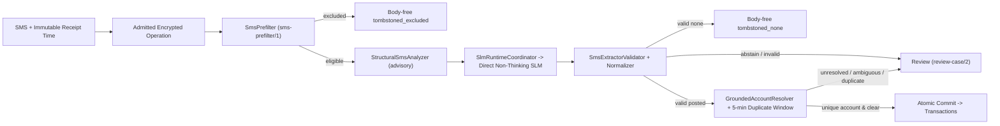

# Architecture & Invariants

Pocket Financer Android is a 6-module Kotlin/Android application implementing an
offline, encrypted, grounded SMS financial processing pipeline.

## Module Graph

```text
:app        Compose Material 3 UI, Navigation, ViewModels, Hilt root, telemetry, Review UI
  ├── :pipeline   DefaultSmsProcessingCoordinator, SmsPrefilter, StructuralSmsAnalyzer,
  │               SmsExtractorValidator/Normalizer, SmsContractAssets, WorkManager scheduling
  ├── :inference  SlmRuntimeCoordinator, LlamaEngine (llama.cpp JNI), DefaultDirectCandidateSelector,
  │               NonThinkingOutputGuard, ModelDownloader / ParallelRangeDownloader
  ├── :data       AppDatabase (Room v8 + SQLCipher AES-256), migrations v1–v8, DAOs,
  │               SmsProcessingStore, SmsReviewRepository, GroundedAccountResolver
  ├── :sms        SmsReceiver (BroadcastReceiver), SmsReader (ContentProvider), SmsRepository
  └── :hardware   DeviceCapabilities profiler, SlmSelector, active tier resolution
```

## Consolidated SMS Pipeline (`pocketfinancer.sms-pipeline/1`)

All new SMS operations execute through one contract release
(`pocketfinancer.sms-pipeline/1`) coordinated by
`DefaultSmsProcessingCoordinator`.



### Stage Responsibilities

1. **Admission & Snapshot (`SmsOperationSnapshotFactory`, `SmsProcessingStore`)**:
   Persists the unchanged SMS body, sender, source identity, immutable receipt
   timestamp, release manifest hash, currency/profile hashes, per-operation GBNF
   grammar flag (default `false`), and real GGUF SHA-256 model identity into an
   owner-claimed operation row.
2. **Pre-SLM Exclusion (`SmsPrefilter` / `sms-prefilter/1`)**:
   Deterministically excludes empty bodies, no-digit messages, gaming promos,
   collect/mandate requests, OTP/verification codes, telecom/data alerts,
   brokerage EOD summaries, and messages with no financial cue. Excluded messages
   settle immediately as **body-free `tombstoned_excluded`** records
   (`rawMessage = ""`, retaining only `sourceId`, body SHA-256 digest, safe
   reason code, and timestamp) without invoking the analyzer or SLM.
3. **Advisory Structural Analysis (`StructuralSmsAnalyzer`)**:
   Produces clause segments, normalized Unicode spans, candidate amounts,
   directions (blocked inside negated/pending/request/expectation/hold clauses),
   accounts (bank, card, VPA), counterparties, and cues. This output is strictly
   **advisory**—it assists the model and reviewer but never acts as a terminal
   allowlist or semantic verdict.
4. **Direct Non-Thinking SLM Extraction (`DefaultDirectCandidateSelector`)**:
   Executes one direct JSON extraction pass with chat-template thinking disabled
   for every model tier. `NonThinkingOutputGuard` aborts immediately on a
   non-JSON opening token or streamed/final thought markers across token
   boundaries, recording `runtime_mode_violation` without storing or displaying
   violating output. No thinking fallback exists.
5. **Strict Host Validation & Normalization (`SmsExtractorValidator`, `SmsExtractorNormalizer`)**:
   Validates schema, UTF-8 byte limits, exact Unicode-scalar spans against the
   unchanged source text, and exact minor-unit money parsing (`CurrencyProfileRegistry`).
   If validation or normalization fails, safely grounded partial fields are
   collected independently for Review.
6. **Account Resolution, Duplicate Window & Routing**:
   - `valid none` -> settles as body-free `tombstoned_none`.
   - `abstain` or validation/runtime failure -> retains for `Review`.
   - `posted` -> resolves normalized account reference (card/bank suffix or VPA)
     via `GroundedAccountResolver` against confirmed owned account aliases, and
     checks source-event idempotency, transaction fingerprint, and the **5-minute
     duplicate window (`300_000` ms)** across `(accountId, direction, minorUnits,
     currency)` excluding the current source/operation.
   - Complete valid `posted` extractions with one uniquely resolved account and a
     clear duplicate assessment persist in **one Room transaction** (transaction,
     initial revision, processing result, persistence decision, and owner-fenced
     settlement). Any unresolved/ambiguous account, possible duplicate, or write
     conflict routes to `Review`.

## Cross-Repo Contract Synchronization

Canonical contract files are owned by
[pocket-financer-intelligence](https://github.com/pocket-financer/pocket-financer-intelligence):

- **Android packaged assets** (`pipeline/src/main/assets/sms_processing/`):
  `release-manifest.json` plus 17 Android artifacts (prompt, GBNF grammar, 7
  profiles, 8 schemas; 2 iOS-only Apple Foundation Models artifacts are skipped
  by `SmsContractAssets`).
- **Golden prefilter vectors** (`pipeline/src/test/resources/prefilter-vectors.json`):
  54 synthetic vectors verified by `SmsPrefilterTest`.
- **Line-ending invariant**: `.gitattributes` pins both directories to `eol=lf`.
  `SmsContractAssets.verify()` hashes raw asset bytes at runtime and fails closed
  on any CRLF byte (`\r`) or digest mismatch.

## Runtime, Model Identity & Performance

- **Single runtime boundary**: All production inference flows acquire leases
  through `SlmRuntime` / `SlmRuntimeCoordinator` (coordinated with app-level
  flows via `SlmAppFlowCoordinator`). Callers must not access `LlamaEngine`
  directly.
- **File-backed model identity**: `SmsModelIdentity` enforces a real 64-char
  lowercase SHA-256 of the loaded GGUF file bytes for every eligible operation.
- **CPU & KV cache tuning**:
  - Arm KleidiAI micro-kernels enabled on `arm64-v8a` (`dotprod`, `i8mm`, `sme`).
  - Dynamic KV cache precision: `F16` when native FP16 hardware is present,
    `Q8_0` fallback otherwise.
  - Native auto-threading (`0` delegates to `llama.cpp`, capping performance
    threads sensibly without thermal thrashing).
  - Disk-backed static prefix KV cache (`session_<sha256>.bin`) keyed to the
    prompt prefix hash, automatically pruning stale session files when
    `prompts/sms-extractor.txt` changes.
  - Parallel HTTP Range downloads write to `.part` temporary files and publish
    atomically only after transport completion.

## Security, Persistence & Recovery

- **SQLCipher Room v8**: Encrypted with AES-256 using a random key stored in
  Android Keystore-backed encrypted preferences (`EncryptedSharedPreferences`).
  Initialization fails closed if Keystore is unavailable. Explicit schema
  migrations cover `v1 -> v8` and preserve stored `native-integration-v4`,
  `native-integration-v5`, and `native-integration-v6` history alongside
  `pocketfinancer.sms-pipeline/1`.
- **Opt-in automatic background work**: `SmsReceiver` and `SmsWorkSchedulerImpl`
  check `AutomaticProcessingPreferences` inside a serialized consistency
  boundary. When enabled, raw SMS evidence is admitted into the encrypted Room
  outbox and WorkManager receives **only** the opaque `candidate_key`.
- **Confirmed local financial erase**: Settings exposes a confirmed erase flow
  (`runLocalFinancialEraseCriticalSection` + `LocalFinancialEraseRecovery`) that
  persists an erase marker, pauses/drains active admissions and ledger edits,
  clears all encrypted database tables, cancels financial notifications, resets
  setup state, and recovers automatically on restart if interrupted mid-erase—
  while keeping downloaded GGUF model files intact.

## Review & Transparency Invariants

- Review displays the full immutable SMS with accessible per-field highlights
  and a single active native text selection, plus source-backed quick choices
  and an explicit Debit/Credit fallback when no direction wording appears.
- Confirmation creates or reuses the matching owned account and commits the
  transaction atomically with an initial revision. User edits/corrections append
  immutable, revision-bound `SmsUserFeedbackEventEntity` rows locally and never
  silently become training data.
- Live processing telemetry presents one growing cumulative structured output
  pane, coalesced and fenced by exact operation/attempt/claim, and scrubs
  transient text on completion, cancellation, or stale ownership.
